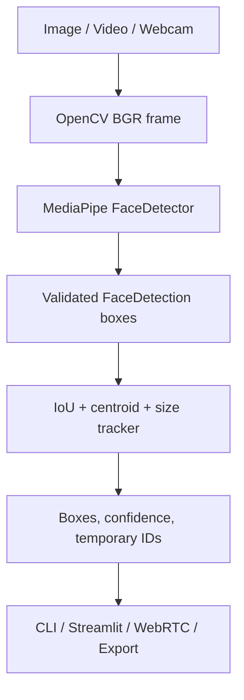

# AI Face Detection & Tracking

## Project overview

Academic Python application for detecting human faces in images and videos,
tracking multiple detections with temporary geometric IDs, processing a local
webcam, and providing a Streamlit interface with an embedded WebRTC webcam.
The system does **not** perform facial recognition or biometric identification.

## Features

- Image face detection.
- Video face detection.
- Multi-face geometric tracking.
- Temporary persistent IDs.
- Local OpenCV webcam.
- Streamlit dashboard.
- Embedded browser webcam through WebRTC.
- Annotated image and video exports.

## Technologies

- **Python**: application and orchestration.
- **OpenCV**: media I/O, color conversion, drawing and encoding.
- **MediaPipe Tasks**: BlazeFace full-range inference.
- **NumPy**: frame representation.
- **Streamlit**: graphical interface.
- **streamlit-webrtc**: browser camera transport.

## System architecture



## Installation

Windows PowerShell:

```powershell
py -3.13 -m venv venv
.\venv\Scripts\python.exe -m pip install -r requirements.txt
.\venv\Scripts\python.exe -m pip check
```

The MediaPipe model must exist at
`models\blaze_face_full_range.tflite`.

## CLI

```powershell
# Image
.\venv\Scripts\python.exe app.py --image images\test.jpg --overwrite

# Video detection
.\venv\Scripts\python.exe app.py --video videos\demo.mp4 --overwrite

# Video tracking
.\venv\Scripts\python.exe app.py --video videos\demo.mp4 --track --overwrite

# Local webcam
.\venv\Scripts\python.exe app.py --camera
```

The local webcam uses an OpenCV window and stops with `Q`.

## Streamlit

```powershell
.\venv\Scripts\python.exe -m streamlit run streamlit_app.py
```

For Streamlit Community Cloud, the repository pins Python 3.11 in
`runtime.txt` and uses `opencv-python-headless` for the Linux server
environment. After changing dependencies, use **Reboot app** or **Clear cache
and reboot** in the Cloud app settings.

### Application guide

- **Dashboard**: model availability, capabilities and session statistics.
- **Image Detection**: upload, confidence threshold, annotation and PNG download.
- **Video Tracking**: upload, tracking configuration, progress, preview and MP4 download.
- **Live Webcam**: browser camera through WebRTC, live boxes, IDs, confidence and FPS.

WebRTC camera access requires browser permission and normally localhost or
HTTPS. A remote deployment may require STUN/TURN configuration.

## Tracking algorithm

Detections are deduplicated with IoU-based NMS. Candidate associations use
predicted position, centroid distance, IoU and bounding-box size consistency.
Matching is deterministic and one-to-one. Tracks become confirmed after
`MIN_TRACK_HITS`, remain temporarily missing, and expire by frame/time limits.
IDs are session-scoped labels, not real-world identities.

## Performance

Measured on `videos\demo.mp4` (1920×1080, 214 frames, source 23.98 FPS):

| Mode | Measured FPS |
|---|---:|
| CLI video detection | 14.73 |
| CLI video tracking | 13.17 |
| Streamlit video tracking | 11.52 |
| Local webcam sample | 13.03 |
| WebRTC browser | N/A |

The local webcam value is a 30-frame sample at 640×480. WebRTC browser FPS is
not claimed because no sustained browser-camera benchmark was captured.

## Testing

```powershell
.\venv\Scripts\python.exe -m unittest discover -s tests -v
```

Final result: 46 tests passed.

## Project structure

```text
app.py                 CLI entry point
streamlit_app.py       Streamlit entry point
config.py              Configuration
detector.py            MediaPipe detector
tracker.py             Geometric tracker
visualization.py       OpenCV annotations
video_processor.py     CLI video pipeline
camera_processor.py    CLI webcam pipeline
ui/                    Streamlit pages and WebRTC processor
tests/                 Unit and integration-style tests
docs/                  Audit, reports and guides
models/                MediaPipe model
images/, videos/       Input media
output/                Generated outputs
```

## Limitations

Detection quality depends on lighting, face size, pose and occlusion. IDs can
change after long disappearances, heavy occlusion or crossing trajectories.
Codec support depends on the local OpenCV installation and browser. No
ground-truth dataset is included, so precision, recall, F1, mAP, IDF1 and MOTA
were not calculated.

## Privacy

Frames are processed locally by the active application. Webcam recording is
not automatic. Exported files remain in `output/` until removed. Temporary
uploaded video files are deleted after processing. See
`docs/privacy_and_limitations.md`.

## Future improvements

- Add a manually annotated evaluation subset.
- Add reproducible browser-camera performance measurements.
- Improve occlusion and crossing handling.
- Configure STUN/TURN for remote WebRTC deployments.
