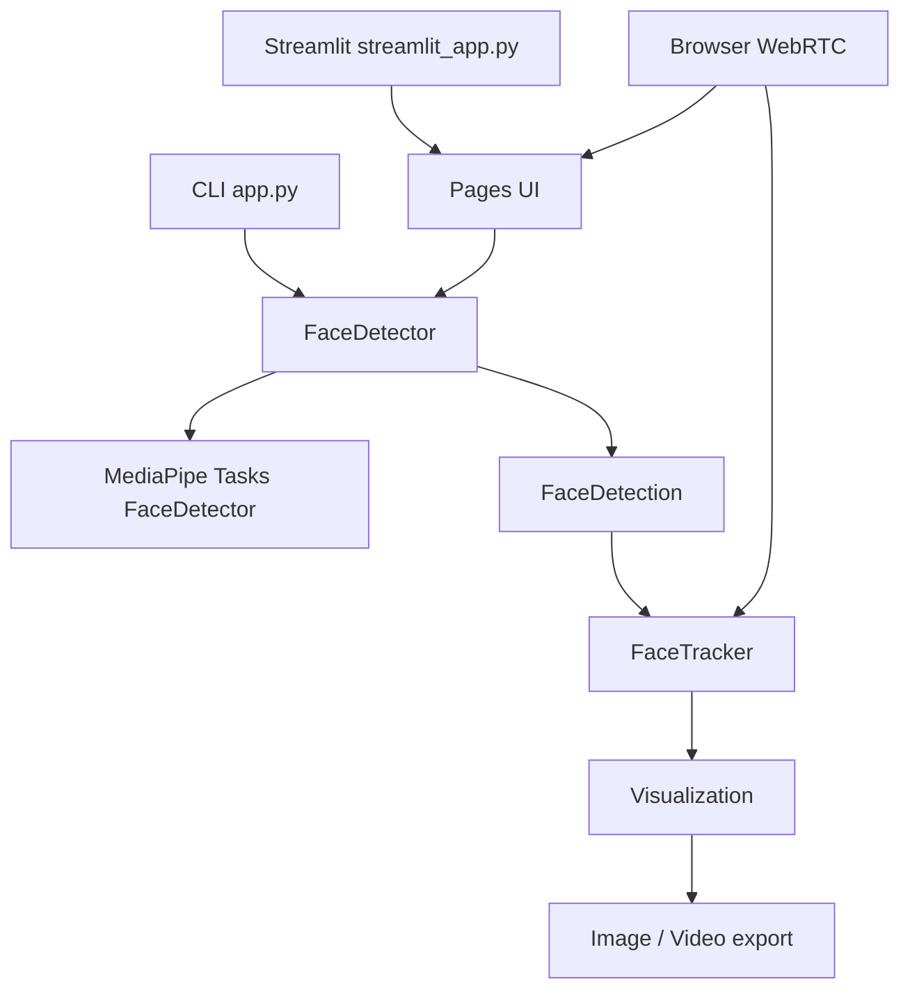

# Audit d'architecture

## Périmètre

Audit réalisé sur l'implémentation Phase 5, avec l'environnement Python du
projet et les médias `images/test.jpg` et `videos/demo.mp4`.

## Architecture actuelle

- `detector.py` valide les images, convertit BGR vers RGB et réutilise un modèle
  MediaPipe en mode IMAGE.
- `tracker.py` réalise une association géométrique un-à-un, une NMS des
  détections, la confirmation et l'expiration temporelle des pistes.
- `video_processor.py` et `camera_processor.py` gèrent les ressources OpenCV
  dans des blocs `try/finally`.
- `ui/video_page.py` fournit le traitement Streamlit avec progression et
  fichiers temporaires.
- `ui/webcam_page.py` utilise un processeur WebRTC par session, avec verrou et
  libération dans `on_ended`.

## Points forts

- Modèle MediaPipe chargé une fois par session de traitement.
- Séparation claire détection, tracking, visualisation et interfaces.
- Tests déterministes du tracker et validation de fichiers importés.
- NMS, association un-à-un et pistes manquantes masquées à l'affichage.
- Nettoyage des captures, writers, détecteurs et temporaires.
- Traitement webcam WebRTC isolé par instance.

## Issues identifiées

| Sévérité | Sujet | Décision |
|---|---|---|
| Haute | La webcam WebRTC dépend des permissions navigateur et d'un contexte sécurisé | Documenté ; validation manuelle requise |
| Moyenne | Le traitement vidéo Streamlit duplique une partie du pipeline CLI | Conservé pour ne pas modifier le contrat existant ; refactor futur possible |
| Moyenne | Les métriques de précision ne sont pas calculables sans annotations | Documenté ; aucune métrique inventée |
| Faible | Plusieurs sorties historiques existent dans `output/` | Conservées comme artefacts de validation ; non nécessaires au runtime |
| Faible | Le README historique décrivait encore la Phase 2 | Corrigé dans cette phase |

## Corrections réalisées

- Ajout des rapports de test, performance, architecture et confidentialité.
- Mise à jour du README pour refléter les Phases 3, 4 et WebRTC.
- Ajout d'un guide utilisateur, technique, académique et de démonstration.
- Validation des dépendances avec `pip check`.

## Risques résiduels

Le tracking reste géométrique et ne garantit pas une identité réelle lors
d'occlusions, croisements ou longues disparitions. Un déploiement WebRTC
distant peut nécessiter STUN/TURN.
